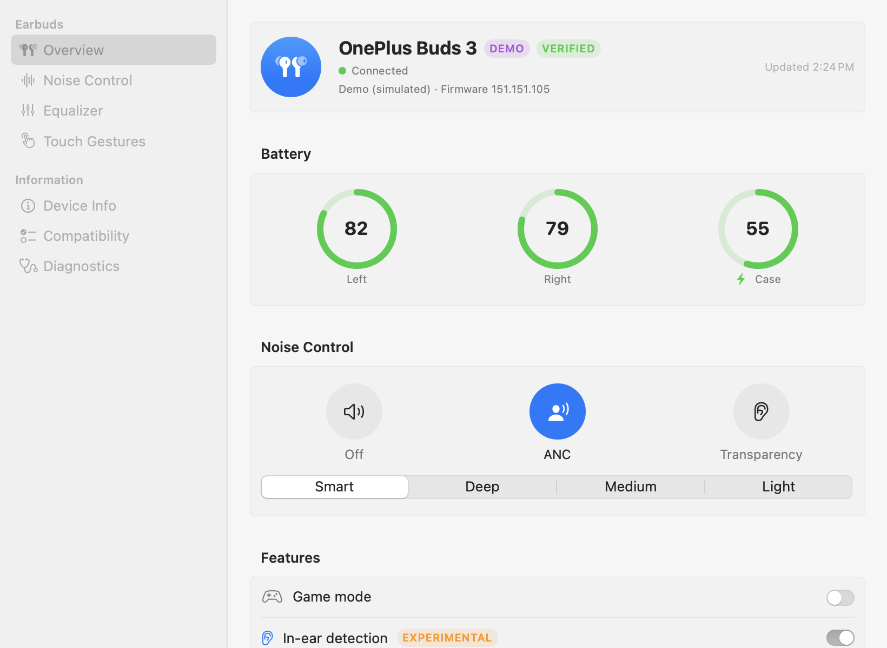
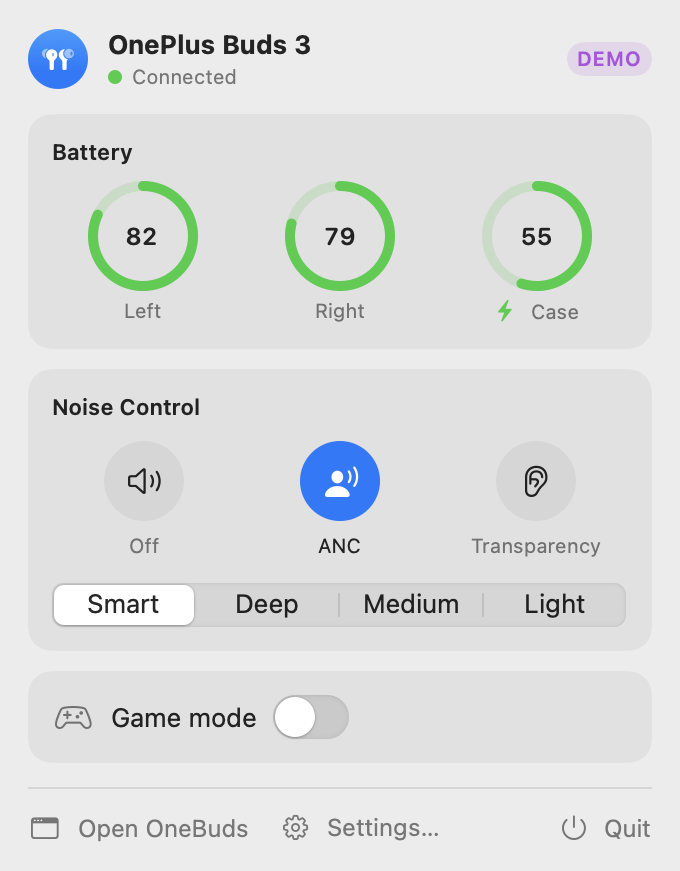
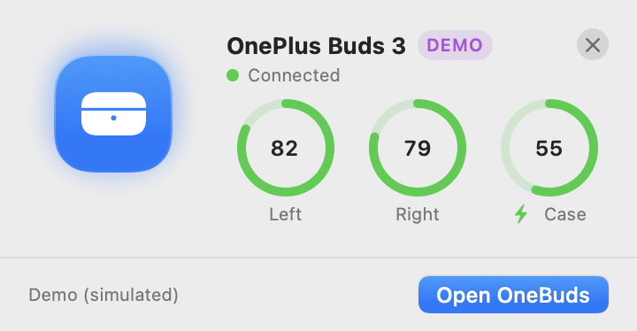
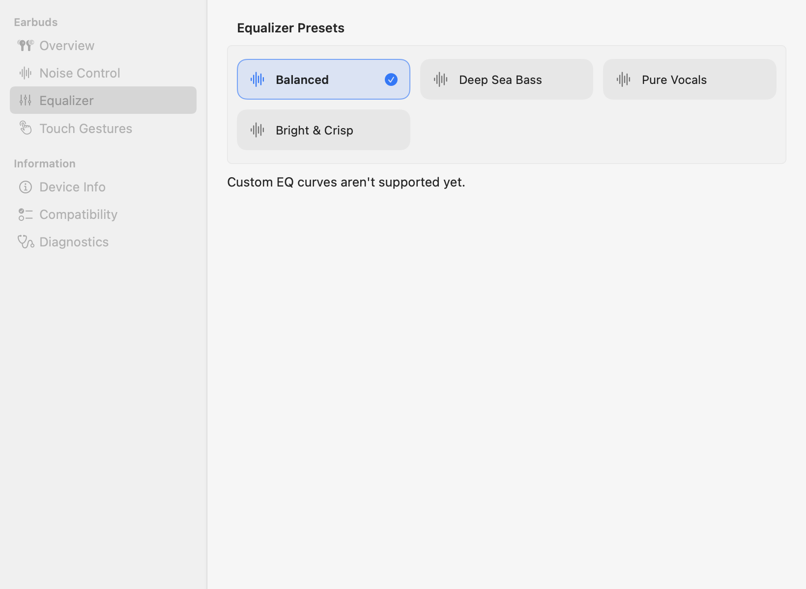
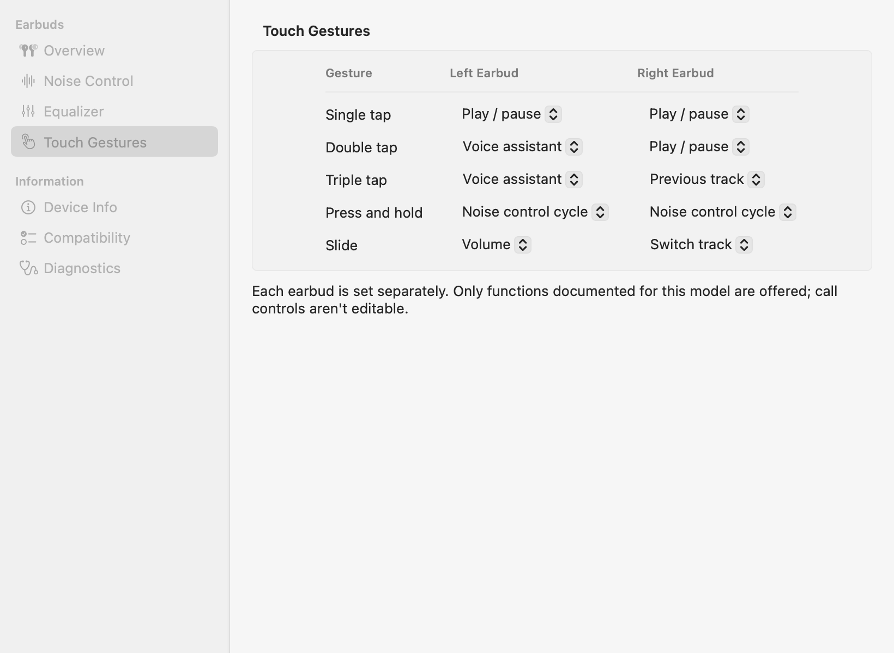
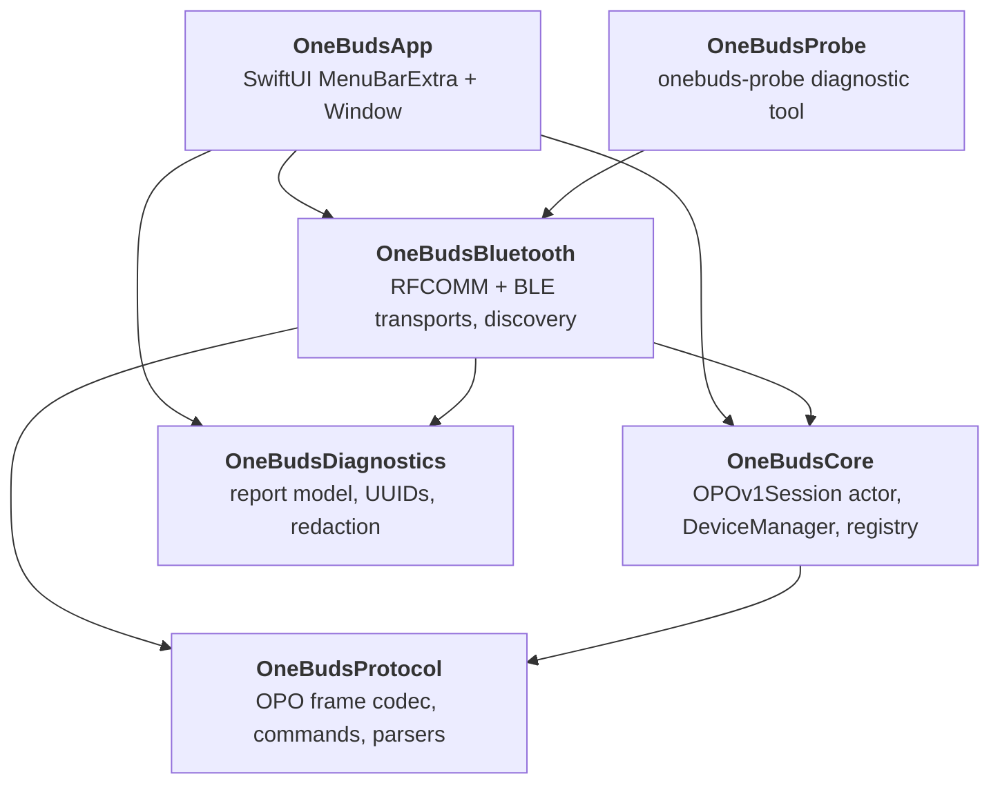
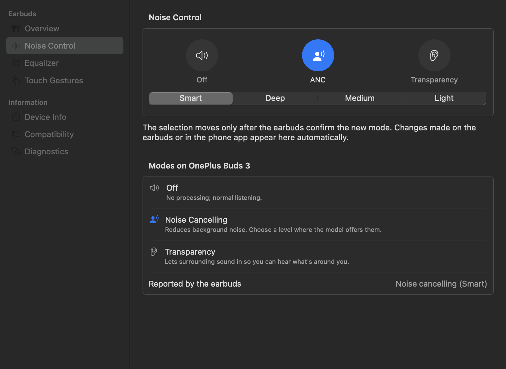
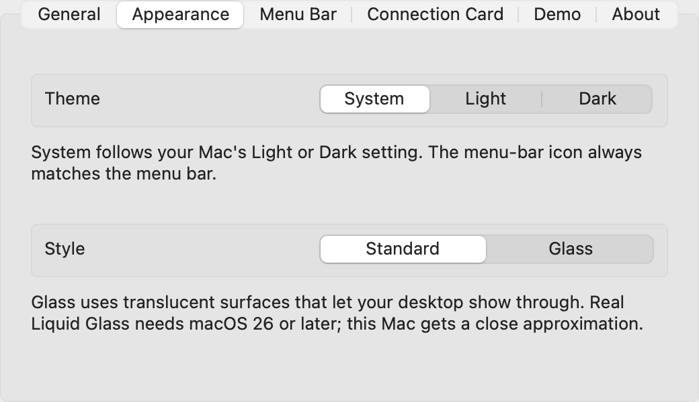

<div align="center">


# OneBuds

**Control your OnePlus, OPPO and realme earbuds from the macOS menu bar.**

No phone, no HeyMelody, no account, no network. Just Bluetooth.

[](#build-and-run)
[](https://swift.org)
[](#architecture)
[](#build-and-run)
[](#build-and-run)
[](THIRD_PARTY_NOTICES.md)

[Features](#features) · [Supported models](#supported-models) · [Build and run](#build-and-run) · [Architecture](#architecture) · [Privacy](#privacy-and-safety) · [Troubleshooting](#troubleshooting)

<br>

<picture>
  <source media="(prefers-color-scheme: dark)" srcset="Documentation/Screenshots/window-overview-dark.png">
  
</picture>

</div>

<br>

## Why OneBuds?

OnePlus Buds sound great on a Mac, but every setting lives in an Android or iOS app. OneBuds is a small native app that talks to the earbuds directly over Bluetooth:

- 🎧 **Native and light.** A SwiftUI menu-bar app with a stripped binary of about 2.2 MB, around 14 MB of memory and 0.0% CPU when idle.
- ✅ **Honest.** A setting shows as changed **only after the earbuds confirm it**: the earbuds acknowledge the command, then a read-back must match. The app never invents battery levels or settings.
- 🔒 **Private.** Fully local, with no network, analytics or crash reporting.
- 🧪 **Tested on hardware.** Every feature of the OnePlus Buds 3 is verified on real earbuds. Untested features say so with an **Experimental** badge.

## Features

<table>
<tr>
<td width="50%" valign="top">

### Menu-bar popover

- Connection state at a glance
- Left, right and case battery rings, with charging indicators
- Noise-control modes, with an ANC level picker on models that have levels
- Game mode
- Open OneBuds, Settings… (<kbd>⌘</kbd><kbd>,</kbd>) and Quit

</td>
<td width="50%" align="center">

<picture>
  <source media="(prefers-color-scheme: dark)" srcset="Documentation/Screenshots/popover-dark.png">
  
</picture>

</td>
</tr>
<tr>
<td width="50%" align="center">

<picture>
  <source media="(prefers-color-scheme: dark)" srcset="Documentation/Screenshots/card-connected-dark.png">
  
</picture>

</td>
<td width="50%" valign="top">

### Connection card

When the earbuds connect, a small floating card appears at the top right of the screen, like AirPods do on a Mac.

- Shows the model, status and the battery levels the earbuds actually reported
- Appears about 0.5 s before the handshake finishes, and turns from "Connecting…" to "Connected" live
- Never takes focus from the app you are in
- Leaves after 6 s, or stays while the pointer is on it

</td>
</tr>
</table>

### Main window

| Section | What it does |
|---|---|
| **Overview** | Hero card, battery, noise control and feature toggles |
| **Noise Control** | Off, ANC and Transparency, plus ANC levels per model |
| **Equalizer** | The model's EQ presets as cards |
| **Touch Gestures** | A Left / Right table for each gesture, offering only functions documented for that model |
| **Device Info** | Model, firmware components and transport |
| **Compatibility** | What each known model supports, and the evidence behind it |
| **Diagnostics** | Read-only Bluetooth inspection, an opt-in packet log, and redacted export |

<p align="center">
  
  
</p>

### Also included

- **Follows changes made elsewhere.** Changes from the earbuds' buttons or the phone appear automatically, through push events.
- **Reconnects automatically** when the buds leave the case, after sleep, and when Bluetooth comes back on.
- **Keyboard shortcuts** in the Earbuds menu.
- **Appearance settings:** Theme (System, Light or Dark) and Style (Standard or Glass). Glass uses real Liquid Glass when built with the macOS 26 SDK and run on macOS 26 or later, and falls back to Standard when Reduce Transparency is on.
- **Demo mode** with a simulated-model picker, so you can preview each model's controls without earbuds. It is labelled **DEMO** everywhere.
- **Launch at login** and an optional battery percentage in the menu bar.

#### Keyboard shortcuts

| Action | Shortcut |
|---|---|
| Refresh | <kbd>⌘</kbd><kbd>R</kbd> |
| Show Connection Card | <kbd>⇧</kbd><kbd>⌘</kbd><kbd>I</kbd> |
| Noise control: Off / ANC / Transparency | <kbd>⌘</kbd><kbd>1</kbd> / <kbd>⌘</kbd><kbd>2</kbd> / <kbd>⌘</kbd><kbd>3</kbd> |
| Settings | <kbd>⌘</kbd><kbd>,</kbd> |

## Supported models

| Model | Status | Notes |
|---|---|---|
| **OnePlus Buds 3** (`063C14`) | 🟢 **Verified** (fw 127.127.101) | Classic Bluetooth, RFCOMM channel 15. Verified: battery, all noise modes and ANC levels, EQ presets, game mode, touch gestures, device info and live updates. Experimental: in-ear detection and dual connection. |
| OnePlus Nord Buds 3 Pro (`064414`) | 🟡 Experimental | The protocol reference model. Not tested with OneBuds. |
| realme Buds Air 5 (`062012`) | 🟡 Experimental | The same OPO protocol with realme's own values: noise levels Light / Deep / Medium / Smart, realme EQ presets and gestures. Tries the 079A service first, then the standard serial port. Not yet tested on hardware. |
| realme Buds T300 (`062412`) | 🟡 Experimental | As for the Air 5, but noise control has no levels (Off / Transparency / ANC) and there is no in-ear detection. Not yet tested on hardware. |
| realme Buds Wireless 2 | 🔴 Unsupported | Uses realme's older, undocumented realme Link protocol, not OPO. Adding it needs an Android Bluetooth capture. |
| Other realme TL models (Air 5 Pro, Air6, Air6 Pro, Air7 Pro, T310) | ⚪ Unknown | Diagnostics only. |
| Other OnePlus models (Buds 4, Pro 2/3, Nord Buds 3, Buds Pro) | ⚪ Unknown | Diagnostics only. OneBuds never sends commands to them. |

Unsupported features are hidden, and experimental ones carry an **Experimental** badge. The evidence for every feature is in [Documentation/Features.md](Documentation/Features.md). Sources and licences are in [Documentation/ProtocolSources.md](Documentation/ProtocolSources.md).

> [!TIP]
> Own one of the experimental models? Running the [hardware test checklist](Documentation/HardwareTestChecklist.md) and sharing the redacted results is the fastest way to get it marked **Verified**.

## Build and run

**You need:** macOS 14 or later, Apple's Command Line Tools (`xcode-select --install`) and Swift 6. Xcode is **not** needed.

```sh
git clone https://github.com/himanshudev28/OneBuds.git
cd OneBuds

# One-time: create a local code-signing identity so macOS remembers the Bluetooth permission
scripts/setup-signing.sh

# Build build/OneBuds.app. --install also copies it to /Applications and opens it.
scripts/build-app.sh --install

# Run the tests (swift-testing, works without Xcode)
swift test
```

On first launch, macOS asks for Bluetooth access for **OneBuds**. Click **Allow**. Then connect your earbuds to the Mac for audio in System Settings → Bluetooth, and OneBuds finds them.

<details>
<summary><b>Permissions and configuration</b></summary>

<br>

| Item | Value |
|---|---|
| `NSBluetoothAlwaysUsageDescription` | Set in `Packaging/OneBuds-Info.plist` |
| `LSUIElement = YES` | A menu-bar app with no Dock icon. A Dock icon appears only while the main window is open. |
| Sandbox | **Not sandboxed.** A sandboxed build would need the `com.apple.security.device.bluetooth` entitlement. |
| Signing | A local self-signed identity, "OneBuds Local Signing", in its own keychain (`scripts/setup-signing.sh`, undo with `scripts/remove-signing.sh`). The designated requirement stays the same across rebuilds, so the permission is kept. |
| Bundle IDs | `com.local.onebuds` (app), `com.local.onebuds.probe` (diagnostic tool) |

If Bluetooth access was denied, the app explains this and links to **System Settings → Privacy & Security → Bluetooth**.

</details>

<details>
<summary><b>Sharing the app with other people</b></summary>

<br>

Builds are signed locally for your Mac. To distribute the app, sign it with a **Developer ID Application** certificate (Apple Developer Program), enable the hardened runtime (`codesign --options runtime`), and notarize it (`xcrun notarytool submit … --wait`, then `xcrun stapler staple`). Both steps need tools that ship with Xcode. There are no Mac App Store plans.

</details>

## Architecture

OneBuds is a SwiftPM package of six modules. The protocol and diagnostics layers import no Apple frameworks, so they are fully unit-tested without Bluetooth.



| Module | Responsibility |
|---|---|
| `OneBudsProtocol` | Framework-free OPO frame codec (LEB128 length, resync), commands, reply parsers and the redaction rule |
| `OneBudsCore` | The `EarbudTransport` protocol, `MockTransport` and simulator, the `DeviceProfile` registry, `OPOv1Session` (an actor), `DeviceManager` (`@MainActor @Observable`) and `DemoConnector` |
| `OneBudsBluetooth` | `RFCOMMTransport` (IOBluetooth), `BLETransport` (Core Bluetooth), `BluetoothConnector` (discovery: connected BLE → paired classic → BLE scan) and read-only inspectors |
| `OneBudsDiagnostics` | Framework-free report model, UUID catalogue and address redaction |
| `OneBudsApp` | SwiftUI `MenuBarExtra` and `Window`. Views hold no Bluetooth or protocol logic. |
| `OneBudsProbe` | The `onebuds-probe` diagnostic tool: read-only by default, and `session` runs the approved query probe |

**Design rules**

- **Concurrency:** Swift 6 language mode with strict concurrency checking, and no suppressed warnings. Core Bluetooth and IOBluetooth objects stay on the main actor, and callbacks are copied, then hopped. The protocol session is an actor.
- **Transports are single-use.** A reconnect creates a new transport, and every value learned from the device is reset on disconnect.
- **Per-model parameters live in [`DeviceRegistry.swift`](Sources/OneBudsCore/DeviceRegistry.swift):** product IDs, noise-mode bytes, EQ presets, writable feature IDs and allowed gesture functions. Nothing model-specific is hard-coded in the protocol layer.
- **Code layout:** the app is organized by feature (`App/`, `Design/`, `Components/`, `ConnectionCard/`, `Popover/`, `Window/`, `Settings/`, `Dev/`), one type per file.

<details>
<summary><b>UI design notes</b></summary>

<br>

- **Native and restrained:** semantic colors and the system accent, continuous corner radii of 8 and 12 pt, and tokens in [`Theme.swift`](Sources/OneBudsApp/Design/Theme.swift).
- **Motion is for state changes only:** critically damped springs of 250–300 ms, no looping or decorative animation, and press feedback at 0.97 scale. The selection highlight slides only once the device confirms.
- **The connection card is the one deliberate exception,** because it marks an event rather than a state change. It enters with a 450 ms spring with a slight overshoot (a fade, scaling from 92 % and a 12 pt drop) and leaves in 200 ms. A 3D model, when one exists, sways about ±20° around a three-quarter view over 10 s, eases in from rest and never makes a full turn. Settings can turn this off.
- **Reduce Motion** replaces all movement with short cross-fades, and the 3D model holds still.

<p align="center">
  
  
</p>

</details>

<details>
<summary><b>Connection card details and artwork</b></summary>

<br>

- It appears on every connection, including quick case-out/case-in cycles. Refreshes, battery updates and wake re-reads never bring it back.
- Before the first read it shows "Reading battery…", and "Battery not reported" if the earbuds never send one.
- Close it with its ✕ button. Right-click it to stop it appearing automatically; **Earbuds ▸ Show Connection Card** (<kbd>⇧</kbd><kbd>⌘</kbd><kbd>I</kbd>) brings it back any time.
- **Settings ▸ Connection Card** controls automatic display, the hide delay (4, 6 or 10 seconds, or until closed), which artwork it may use (3D model, product image or symbol), whether a 3D model sways, and a Show Card Now button.
- Each announcement is logged: `log stream --info --predicate 'subsystem == "com.local.onebuds"'`, category `card`.
- Its logic is in `ConnectionAnnouncementGate` (Core) and `ConnectionCardPresenter` (app). The card only observes `DeviceManager` and never calls into it.

**Artwork** is looked up by profile ID in `Packaging/EarbudAssets/`, which `scripts/build-app.sh` copies into the app:

- `<profile-id>.usdz`: a 3D model, shown with RealityKit (`ARView`, so macOS 14 works too)
- `<profile-id>.png` or `.heic`: a product render

The card uses the model, else the render, else a generic earbuds-and-case symbol. A file that fails to load falls through to the next.

**No artwork ships today.** A search in October 2026 found no licensed OnePlus Buds 3 model or render (Sketchfab had none; TurboSquid and CGTrader had only paid models of the original 2020 OnePlus Buds; Cults3D had a case STL with an unconfirmed licence; Wikimedia Commons had no photos). Only licensed artwork of the exact model belongs there.

To check a new model before shipping it, run `ONEBUDS_ARTWORK_CHECK=<dir> build/OneBuds.app/Contents/MacOS/OneBuds`. It renders each bundled `.usdz` through the card's scene at rest and mid-sway on light and dark backgrounds, checks that the background is transparent, and checks that a broken file falls back. A window flashes briefly at the bottom left, because Metal only renders on screen.

</details>

## Diagnostic tool

```sh
scripts/build-probe.sh
scripts/run-probe.sh            # read-only: SDP records, RFCOMM channels, GATT services
scripts/run-probe.sh session    # owner-approved query probe: handshake, product ID, firmware, battery
```

Reports go to `Diagnostics/`, which git ignores. Addresses, serial numbers and the multi-device list are redacted by default.

The app has two development aids, each triggered only by an environment variable:

- `ONEBUDS_SNAPSHOT_DIR=<dir>` renders every screen in Demo mode to PNG files. The screenshots in this README were made this way.
- `ONEBUDS_SELFTEST_OUT=<file>` runs the real read-only startup and writes a summary.

## Privacy and safety

- 🌐 **Fully local:** no network, analytics or crash reporting.
- 📦 **Raw packet logging** is opt-in and kept in memory only.
- 🕶️ **Exports are redacted.**
- 🛑 **Never sent:** firmware updates, factory resets, power-saving (`0x17`) or Hi-Res (`0x18`) commands. Nothing outside the model's profile is sent.

## Energy and performance

| Measurement (2026-10-12, release build) | Result |
|---|---|
| Memory, Demo mode, cards off | 14 MB |
| Memory after a connection card has shown | 19 MB (system SwiftUI/AppKit code loaded on first use) |
| Installed app with real Buds 3 connected | 21 MB |
| Idle CPU | 0.0%, about 1 wakeup per second |
| Release binary (stripped) | about 2.2 MB |

- No polling once connected: the buds push changes.
- While disconnected, OneBuds waits for macOS "device connected" notifications. Automatic retries back off to every 2 minutes and never run a Bluetooth scan. Scans happen only at launch or when you click Connect or Try Again.
- Packet formatting is skipped unless packet logging is on.
- The card window is created on the first card. 3D views exist only while a card with a `.usdz` is up, and a still image replaces the live view when the model is held still.

## Troubleshooting

| Symptom | What to do |
|---|---|
| "No supported earbuds connected" | Connect the buds to the Mac for audio first (System Settings → Bluetooth). OneBuds never pages buds that are not connected. |
| "Bluetooth permission needed" | System Settings → Privacy & Security → Bluetooth → enable OneBuds. If you rebuilt with ad-hoc signing, run `scripts/setup-signing.sh` and rebuild. |
| "Refused: put at least one earbud in your ear" | Noise control works only while a bud is worn (status `0x0E`). |
| "No confirmation from the earbuds" | The earbuds did not answer within 2.5 s. The setting may not have changed, so OneBuds keeps showing the last confirmed value. |
| Stuck after waking from sleep | Overview → Disconnect, then Connect. Please export Diagnostics and report it. |
| `open` fails with error -10810 | The output file passed to `open --stdout` already existed. The scripts handle this. |
| The phone's HeyMelody app interferes | Untested (see [the checklist](Documentation/HardwareTestChecklist.md)). Close HeyMelody, or turn off the phone's Bluetooth. |

## Documentation

| Document | Contents |
|---|---|
| [Features.md](Documentation/Features.md) | Every feature, per model, with the evidence for its status |
| [ProtocolSources.md](Documentation/ProtocolSources.md) | Protocol references, licences, revisions and decoded facts |
| [HardwareTestChecklist.md](Documentation/HardwareTestChecklist.md) | Step-by-step tests to verify a model on real earbuds |
| [PhaseB-Report.md](Documentation/PhaseB-Report.md) | The original Buds 3 Bluetooth investigation |
| [THIRD_PARTY_NOTICES.md](THIRD_PARTY_NOTICES.md) | Dependencies (none) and attribution |

## Credits

The protocol research behind this app is by Aasheesh, Vedanth Jadhav, spizganed (QuickBuds), Zhaoyi-ya (OppoPodsManager), the OppoPods authors, kunalagra (OtoControl), Aniket Budhwani (OPPO-Earbuds-Mac-Controller) and Vedat Kılıç (galaxy-buds-mac). OneBuds' code is written independently from those documented facts; see [THIRD_PARTY_NOTICES.md](THIRD_PARTY_NOTICES.md).

<br>

<div align="center">

<sub>OneBuds is unofficial and not affiliated with OnePlus, OPPO or realme. All product names are trademarks of their owners.</sub>

</div>
